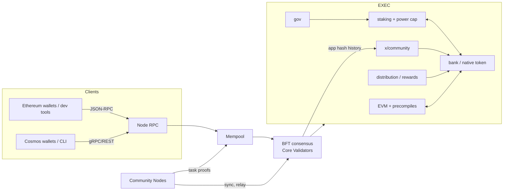

# Architecture — Nira Chain

- Version: 0.1 (2026-11-25)
- Status: draft (ADR-0001…ADR-0005 accepted for build start)

## 1. Overview

Nira is a **sovereign Proof-of-Stake L1** (ADR-0001) with three layers that are deliberately separated:

1. **Consensus core** — a bounded set of stake-weighted Core Validators running a Tendermint-family BFT protocol with single-block finality (ADR-0002). This layer alone decides finality. It must be fully safe and live without anything in layer 3.
2. **Unified execution** — one state machine with native modules *and* an embedded EVM sharing one state, one account/key model (eth_secp256k1), one native token, one fee market and one block (ADR-0005). There is no second chain and no bridge between native and EVM state.
3. **Community participation layer (`x/community`)** — permissionless, bonded Community Nodes that are randomly selected each epoch to produce *cryptographically verifiable* work (state-possession proofs against committed app hashes; later: history serving and DA sampling). It is **off the finality path**: its total failure only reduces community rewards and extra assurance (ADR-0003).

Why this class: we need our own validator roles, a native community role, native EVM and our own fee/reward policy. Contracts on a host or an L2 can't give us a validator set or community roles as protocol primitives. Shared security (ICS/restaking) would put validator selection under someone else's rules, which conflicts with R-F1 and R-F2. So we pay the cost of a sovereign L1: bootstrapping a security budget (see tokenomics) and running a validator ecosystem.

## 2. Actors and node roles

| Role | Does | Count (genesis → target) | Permission | Hardware / connectivity | Stakes / bonds | Rewarded for | Penalised for |
|---|---|---|---|---|---|---|---|
| Core Validator | Proposes, votes and finalises blocks; executes all txs | 4 → 100 active (P-STAKE-max_validators, governable) | Permissionless; top-N by bonded power with min self-bond | 8+ cores, 32 GB, NVMe 2 TB, 1 Gbps, 99.9 % uptime, sentry topology | Self-bond ≥ P-STAKE-min_self_bond plus delegations | Block rewards + fees, weighted by stake; commission | Slash 5 % + tombstone on double sign; 0.01 % + jail on downtime |
| Delegator | Delegates stake to validators (non-custodial, protocol-held) | unbounded | Permissionless | any wallet | Delegated stake (slashable with the validator) | Share of the validator's rewards minus commission | Proportional slash with the validator |
| Community Node | Runs a pruned full node, answers assigned state-proof tasks, relays txs/blocks | 0 → 10 000+ | Permissionless; registers with bond ≥ P-COMM-min_bond | 4 cores, 8 GB, 500 GB SSD, 25 Mbps; may go offline | Community bond (unbonding period applies) | Verified task proofs only, from the community budget | Missed tasks: no reward, assignment weight decays, auto-pause after N misses. Provable fraud: slashing |
| Full Node | Independently validates every block | unbounded | Permissionless | as Community Node | none | none (public good, may also be a Community Node) | n/a |
| Archive Node | Keeps all history, serves historical queries | operators' choice | Permissionless | 16 GB+, multi-TB | none (v2: history-serving tasks) | n/a in v1 | n/a |
| Governance participants | Propose / vote | stakers | stake-weighted | wallet | proposal deposit | n/a | Deposit burned on vetoed spam proposals |

Upgrade path from community to core: anyone can create a validator; the active set is the top-N by bonded power that meet min self-bond. The community-node reputation record (tasks proven) is public, so delegators can use it.

## 3. Trust assumptions

| ID | Assumption | Needed for | If violated |
|---|---|---|---|
| T1 | < 1/3 of active voting power is Byzantine | Safety (no conflicting finalised blocks) | Possible fork; detected via double-sign evidence; social recovery + slashing |
| T2 | > 2/3 of active voting power online and connected | Liveness | Chain **halts** (no finality), safety kept; restart runbook |
| T3 | Partial synchrony (messages eventually delivered within Δ) | Liveness | Rounds increase, block time grows, no safety impact |
| T4 | New/returning nodes obtain a recent trusted header or snapshot within the unbonding period (weak subjectivity) | Long-range attack resistance | Node can be fed a fake history; mitigated by checkpoints from multiple sources |
| T5 | At least one honest, reachable peer per node | Correct view of the chain (eclipse resistance) | Node stalls or sees stale chain; cannot be made to accept invalid blocks (full validation) |
| T6 | Community-layer randomness seed (finalised block hash) is not fully controlled by one proposer | Fair task assignment | A proposer can bias which nodes get tasks in one block; bounded by the hash-onion reveal design (ADR-0003); impact is reward fairness only |
| T7 | No single entity controls > P-STAKE-max_validator_power_share of stake **under one validator** | Concentration limits | Cap enforced per validator; multi-validator sybils remain possible → monitored (K3) |

## 4. Components

| Component | Responsibility | Owner skill | Depends on |
|---|---|---|---|
| CONS — Consensus | BFT block production/finality, evidence, timeouts | protocol-consensus | STAKE (validator set updates) |
| STAKE — Staking & validators | Validator registry, delegation, unbonding, redelegation, slashing/jailing, active set, power cap | protocol-staking-validators | CONS, TOKEN |
| EXEC — Execution & EVM | Native module execution + EVM, gas, fee market, JSON-RPC, precompiles | protocol-state-execution | CONS |
| TOKEN — Tokenomics & rewards | Issuance, fee distribution, reward split validators/delegators/community/treasury | protocol-tokenomics | STAKE, COMM |
| COMM — Community participation | Community node registry, bonds, sortition, task assignment, proof verification, rewards, slashing for fraud | protocol-verifiable-participation | RAND, EXEC (app-hash history), TOKEN |
| RAND — Randomness | Seed for sortition: finalised block hash + per-node hash-onion reveals | protocol-randomness | CONS |
| GOV — Governance | Proposals, voting, param changes, upgrades, treasury spending | protocol-governance | STAKE |
| NET — P2P & sync | Gossip, PEX, sentry topology, state sync snapshots | (protocol-p2p, not installed: general knowledge) | CONS |

## 5. Lifecycles

### Transaction
Submission (Ethereum RLP tx via JSON-RPC or Cosmos tx via gRPC) → CheckTx (signature, nonce, fee ≥ base fee) → gossip (< 0.5 s) → inclusion by proposer → FinalizeBlock execution (deterministic, in block order) → commit; **final after 1 block** (target ≤ 2 s p50, ≤ 4 s p95, proposed). Receipts and logs are indexed by the JSON-RPC indexer of each serving node.

### Block / epoch
Every block: mint + fee collection → distribution (validator/delegator via F1 lazy accounting) → community module stores `(height-1 → app hash)` in a bounded ring (P-COMM-apphash_window) → evidence/slashing → EndBlock validator updates.
Every community epoch (P-COMM-epoch_blocks): close previous epoch (pay community budget pro-rata to verified proofs, bump miss counters), derive new seed, open new assignments.

### Community task (ADR-0003)
1. **Register**: node posts bond and the tip `C_0 = H^K(s)` of a private hash onion.
2. **Self-select**: for epoch e, the node reveals the next onion layer `r_e` (verifiable: `H(r_e) = previous layer`) and is assigned iff `H(seed_e ‖ r_e ‖ addr) < threshold × bond_weight`. Nobody can predict another node's selection; the node cannot grind because `r_e` is fixed at registration.
3. **Task**: for a selected node, the task is a random state key `k = H(seed_e ‖ addr ‖ i)` under a store prefix, at a random recent height `h` within the window.
4. **Proof**: node submits an ICS-23 Merkle proof (membership or non-membership) of `k` against `AppHash(h)` held on-chain.
5. **Settle**: valid proof → recorded as a verified unit of work. Epoch end → community budget split pro-rata. No proof → no reward + miss counter.
6. **Divergence alert**: a node whose locally computed app hash for h differs from the committed one submits a bonded alert. Alerts never affect finality; a threshold of bonded alerts emits an on-chain `divergence` event for operators and governance.

## 6. Failure scenarios

| Scenario | Expected behaviour | Recovery |
|---|---|---|
| > 1/3 consensus power offline | Chain halts, no conflicting blocks | Validators restart; downtime slashing jails absentees after the window |
| Network partition | Minority side cannot finalise; majority finalises if > 2/3 | Partition heals, minority catches up via block sync |
| All Community Nodes disappear | Blocks keep being finalised; community budget for the epoch is not paid out (stays in module/treasury) | None needed |
| Malicious majority of Community Nodes | Cannot affect finality; cannot earn without valid proofs; alerts are advisory | Governance can raise bonds / pause rewards |
| Double sign | Evidence → 5 % slash + tombstone; delegators slashed pro-rata | Validator cannot rejoin with the same key |
| Key compromise of a validator | Attacker can double sign → slash; cannot move delegators' funds | Rotate consensus key (where supported), remote signer |
| EVM DoS / gas griefing | Block gas limit and EIP-1559 base fee bound per-block work | Governance tunes params |
| Governance capture | Timelock-like voting period + quorum + veto; upgrades visible in advance | Validators can refuse to run a malicious upgrade binary |

## 7. Cross-cutting

- **Determinism**: no floats, wall clock, map iteration or local config in state transitions; all randomness from committed data.
- **Upgrades**: on-chain software-upgrade proposals with named upgrade handlers.
- **Governance scope**: all `P-*` parameters, treasury (community pool) spending, upgrades. No admin key; module authority = governance account.
- **Observability**: CometBFT + SDK Prometheus metrics; community module emits typed events for every assignment, proof and payout.

## 8. Open points
See CHAIN.md → Open questions and Risks.
