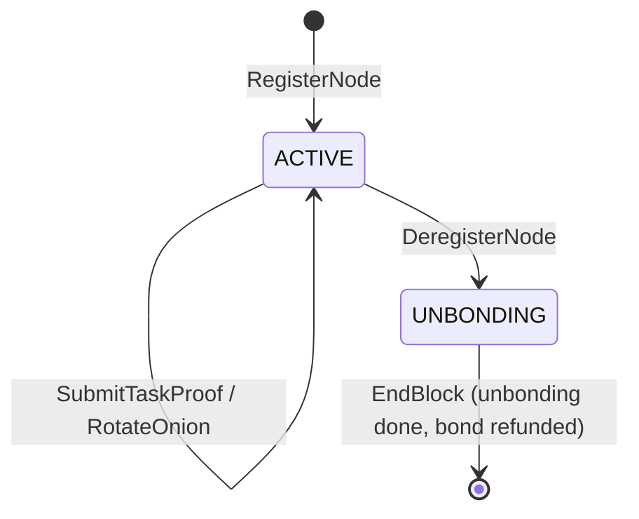
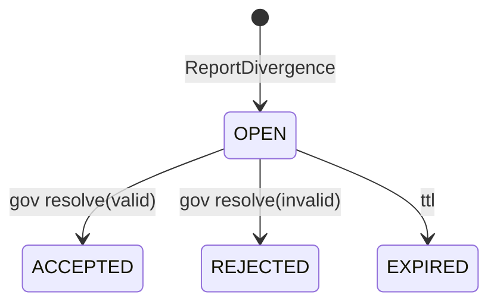

# Spec — COMM: Community Participation Layer

- Version: 0.1 (2026-11-25)
- Status: specified
- Design: ADR-0003. Mechanism skills: protocol-verifiable-participation, protocol-randomness
- Implementation surface: native module `x/community` plus an EVM precompile at `0x0000000000000000000000000000000000000900` (ADR-0006)

## 1. Purpose

Permissionless, bonded Community Nodes earn a bounded share of block rewards **only** for cryptographically verified work. v1 work unit: a **state-possession proof**, an ICS-23 Merkle proof of a pseudo-random key at a pseudo-random recent height, checked on-chain against the committed app hash.

The layer is off the finality path. No consensus or validator-set decision reads COMM state, and COMM's block hooks never halt the chain (INV-COMM-8).

Properties:
- **Unpredictable selection.** A node's selection for epoch e depends on a secret onion layer that it reveals only when it claims the selection.
- **No grinding by the node.** Layers are fixed at commitment time and bound to epoch numbers.
- **Sybil neutrality.** Selection probability and rewards are proportional to bond, with a minimum bond per identity, so splitting stake gains nothing.
- **Absence is free.** An offline node is simply never seen claiming a selection, so it gets no reward. Nobody can observe a miss, so nothing is ever slashed for being offline.

## 2. Context and interfaces

| Uses | For |
|---|---|
| Block header (height, hash, app hash of the previous block) | Seed and app-hash history |
| Bank (module accounts `community`) | Bond escrow, alert deposits, reward pool |
| Fee collector balance (after mint, before distribution) | Reward funding (P-COMM-reward_share_bps) |
| Community pool (distribution) | Destination for undistributed rewards and burned deposits |
| ICS-23 / commitment verification (SDK specs) | Proof verification |

## 3. Types

```
NodeStatus  = ACTIVE | UNBONDING
AlertStatus = OPEN | ACCEPTED | REJECTED | EXPIRED
Hash32      = bytes[32]
Addr        = bytes[20]                    // account address (same bytes for bech32 and 0x forms)
```

## 4. State

| Entity | Key | Fields | Writer | Bound |
|---|---|---|---|---|
| Params | — | §7 | gov | 1 |
| Node | operator Addr | operator, moniker (≤ 64 B), bond: Int, status, registered_epoch: u64, onion_base_epoch: u64, onion_anchor: Hash32, onion_anchor_epoch: u64, onion_length: u32, units_total: u64, unbond_complete_height: u64 | register / rotate / reveal / deregister | 1 per address; cost = min_bond |
| TotalActiveBond | — | Int | register / deregister | 1 |
| Epoch | — (current) | number: u64, start_height: i64, seed: Hash32, eligible_bond: Int, budget: Int, proofs: u32 | BeginBlock | 1 |
| EpochWork | (epoch, operator) | units: u32 | submit proof | ≤ P-COMM-max_proofs_per_epoch per epoch; deleted at settlement |
| TaskDone | (epoch, operator, task_index) | — | submit proof | same bound; deleted at settlement |
| AppHash | height | Hash32 | BeginBlock | ring of P-COMM-apphash_window entries |
| UnbondingQueue | (complete_height, operator) | amount | deregister | 1 per node |
| Alert | id: u64 | reporter, height, claimed_app_hash, deposit, status, expires_height | report / resolve / EndBlock | ≤ P-COMM-max_open_alerts open |
| AlertIndex | (height, reporter) | id | report | 1 per (height, reporter) |
| NextAlertID | — | u64 | report | 1 |

Module account `community` balance = Σ ACTIVE bonds + Σ UNBONDING bonds + Σ OPEN alert deposits + reward pool (INV-COMM-4).

## 5. Derived values (deterministic)

`H = SHA-256`, `‖` = concatenation, integers big-endian: `be8(u64)`, `be4(u32)`.

- **Seed** at epoch start: `seed_e = H("nira/comm/seed" ‖ seed_{e-1} ‖ block_hash(start_height_e) ‖ be8(e))`, with `seed_0 = 0^32`.
- **Onion**: the node picks secret `s` and length `K` and commits `tip = H^K(s)`, valid from `onion_base_epoch = b`. Layer for epoch e (b ≤ e < b+K): `v_e = H^{K-(e-b+1)}(s)`, so `H(v_e) = v_{e-1}` with `v_{b-1} = tip`.
- **Reveal check**: the stored anchor is `(onion_anchor, onion_anchor_epoch)`, initially `(tip, b-1)`. A reveal `r` for epoch e is valid iff `d = e - onion_anchor_epoch` satisfies `1 ≤ d ≤ P-COMM-max_reveal_distance` and `e - b + 1 ≤ onion_length` and `H^d(r) = onion_anchor`. On success the anchor becomes `(r, e)`.
- **Ticket**: `t = uint256(H("nira/comm/ticket" ‖ seed_e ‖ v_e ‖ operator))`.
- **Selected** iff `t · eligible_bond_e < 2^256 · target · bond`, where `target = P-COMM-target_committee`. Exact big-integer arithmetic; if `target·bond ≥ eligible_bond_e`, always selected.
- **Task i** (0 ≤ i < P-COMM-tasks_per_selection), with `x = seed_e ‖ operator ‖ be4(i)`:
  - `height_i = start_height_e − 1 − (be8⁻¹(H("nira/comm/height" ‖ x)[0:8]) mod W)`, where `W = min(P-COMM-apphash_window, start_height_e − 1)`
  - `store_i = sample_stores[be8⁻¹(H("nira/comm/store" ‖ x)[0:8]) mod len(sample_stores)]`
  - `key_i = H("nira/comm/key" ‖ x)`
  - The proof shows membership (with value) or non-membership of `key_i` in store `store_i` at version `height_i`, against `AppHash[height_i]`. Path = `[store_i, key_i]`, specs = SDK specs (IAVL + simple Merkle).

Client note: query `/store/<store_i>/key` with `prove=true` at `height_i`, convert the ProofOps into a commitment MerkleProof, and submit it.

## 6. Operations

All messages are Cosmos SDK msgs, signable with an eth_secp256k1 key (CLI, EIP-712 wallets). The EVM precompile (§10) exposes the same operations to Solidity and Ethereum wallets.

### 6.1 MsgRegisterNode {operator, moniker, bond: Coin, onion_tip: Hash32, onion_length: u32}
Checks:
1. C1 operator is a valid address and the signer → `ErrInvalidSigner`
2. C2 no Node exists for operator → `ErrNodeExists`
3. C3 bond.denom = P-COMM-bond_denom and bond.amount ≥ P-COMM-min_bond → `ErrInsufficientBond`
4. C4 1 ≤ onion_length ≤ P-COMM-max_onion_length and onion_tip ≠ 0^32 → `ErrInvalidOnion`
5. C5 len(moniker) ≤ 64 → `ErrInvalidMoniker`

Effects:
1. E1 transfer bond operator → module `community` (fails if insufficient funds)
2. E2 Node{status=ACTIVE, registered_epoch = epoch.number, onion_base_epoch = epoch.number + 1, onion_anchor = tip, onion_anchor_epoch = epoch.number, …}
3. E3 TotalActiveBond += bond

Event: `node_registered{operator, bond, base_epoch}`.

### 6.2 MsgRotateOnion {operator, onion_tip, onion_length}
Checks: C1, node exists and ACTIVE (`ErrNodeNotActive`), C4.
Effects: `onion_base_epoch = epoch.number + 1`, anchor = `(tip, epoch.number)`, onion_length set.
The new onion is only valid from the next epoch, whose seed is unknown now, so rotation can't be used to grind.

### 6.3 MsgSubmitTaskProof {operator, epoch, reveal: Hash32, task_index: u32, store: string, height: i64, value: bytes, proof: bytes}
Checks, in order:
1. C1 signer
2. C2 node exists, ACTIVE, `registered_epoch < epoch.number` (INV-COMM-3) → `ErrNodeNotEligible`
3. C3 `msg.epoch = epoch.number` → `ErrWrongEpoch` (proofs are accepted only during their epoch)
4. C4 `epoch.number ≥ onion_base_epoch`
5. C5 reveal check (§5): if `onion_anchor_epoch = epoch.number`, require `reveal = onion_anchor`; otherwise run the full check → `ErrInvalidReveal`
6. C6 selected(ticket) → `ErrNotSelected`
7. C7 `task_index < P-COMM-tasks_per_selection` and TaskDone(epoch, op, i) absent → `ErrTaskDone`
8. C8 `epoch.proofs < P-COMM-max_proofs_per_epoch` → `ErrEpochFull`
9. C9 store, height equal the derived `store_i`, `height_i`, and AppHash[height] exists → `ErrWrongTask`
10. C10 `len(proof) ≤ P-COMM-max_proof_bytes`, `len(value) ≤ 4096` → `ErrProofTooLarge`
11. C11 gas consumed: `P-COMM-proof_gas_per_byte × len(proof)`
12. C12 ICS-23 verification: membership if `len(value) > 0`, else non-membership → `ErrInvalidProof`

Effects:
1. E1 if C5 ran the full check: anchor = (reveal, epoch)
2. E2 TaskDone(e, op, i) set; EpochWork(e, op).units += 1; epoch.proofs += 1; node.units_total += 1

Event: `task_proven{operator, epoch, task_index, store, height}`.

### 6.4 MsgDeregisterNode {operator}
Checks: node ACTIVE.
Effects:
- status = UNBONDING, unbond_complete_height = now + P-COMM-unbonding_blocks
- TotalActiveBond −= bond
- UnbondingQueue entry added

Work already proven this epoch is still paid at settlement (it was verified).

### 6.5 MsgReportDivergence {operator, height, claimed_app_hash}
Checks:
1. node ACTIVE and registered before the current epoch
2. AppHash[height] exists and differs from claimed_app_hash → `ErrNoDivergence`
3. no AlertIndex(height, op) → `ErrDuplicateAlert`
4. open alerts < P-COMM-max_open_alerts → `ErrTooManyAlerts`

Effects:
- deposit P-COMM-alert_deposit moves op → module
- Alert{OPEN, expires = now + P-COMM-alert_ttl_blocks}
- If Σ bond of distinct reporters of OPEN alerts for `height` ≥ P-COMM-alert_threshold_bps × TotalActiveBond / 10000: emit `divergence_threshold{height}`. This is advisory only and never touches consensus.

### 6.6 MsgResolveAlert {authority, alert_id, valid: bool} — governance only
Checks: authority = gov module account (`ErrInvalidSigner`); alert OPEN.
Effects:
- valid: refund the deposit, status ACCEPTED
- invalid: deposit → community pool (protocol reserve), status REJECTED

### 6.7 MsgUpdateParams {authority, params} — governance only; `params.Validate()`.

## 7. Parameters

| ID | Type | Default (proposed) | Min | Max | Unit | Notes |
|---|---|---|---|---|---|---|
| P-COMM-bond_denom | string | anira | — | — | | must equal the staking bond denom |
| P-COMM-min_bond | Int | 1 000 NIRA (1e21) | 1 NIRA | 1e9 NIRA | anira | sybil cost per identity |
| P-COMM-epoch_blocks | u64 | 600 | 10 | 100 000 | blocks | ~10–20 min |
| P-COMM-target_committee | u32 | 64 | 1 | 10 000 | nodes/epoch | expected selections per epoch |
| P-COMM-tasks_per_selection | u32 | 2 | 1 | 16 | | |
| P-COMM-max_proofs_per_epoch | u32 | 1 024 | 1 | 10 000 | | bounds settlement work |
| P-COMM-apphash_window | u32 | 100 | 10 | 10 000 | heights | nodes must retain ≥ window + epoch_blocks versions |
| P-COMM-sample_stores | []string | [acc, bank, staking, evm] | 1 item | 16 items | | must be mounted IAVL stores |
| P-COMM-max_proof_bytes | u32 | 16 384 | 1 024 | 65 536 | bytes | |
| P-COMM-proof_gas_per_byte | u64 | 20 | 1 | 1 000 | gas | |
| P-COMM-max_onion_length | u32 | 1 000 000 | 1 | 10 000 000 | epochs | |
| P-COMM-max_reveal_distance | u32 | 4 096 | 1 | 100 000 | hashes | gas-bounds the reveal; longer gaps need a rotation |
| P-COMM-reward_share_bps | u32 | 1 500 | 0 | 3 000 | bps of block rewards+fees | idea's 15 % proposal (Q3) |
| P-COMM-unbonding_blocks | u64 | 100 800 | 1 | 2 000 000 | blocks | ~1–2 weeks |
| P-COMM-max_unbond_per_block | u32 | 100 | 1 | 10 000 | | EndBlock bound |
| P-COMM-alert_deposit | Int | 100 NIRA | 1 NIRA | 1e6 NIRA | anira | |
| P-COMM-alert_ttl_blocks | u64 | 100 800 | 100 | 2 000 000 | blocks | |
| P-COMM-max_open_alerts | u32 | 256 | 1 | 10 000 | | |
| P-COMM-alert_threshold_bps | u32 | 3 334 | 1 | 10 000 | bps of active bond | |

Rule: `tasks_per_selection × target_committee ≤ max_proofs_per_epoch`.

## 8. Hooks

### BeginBlock (order: after mint, before distribution) — must not return errors (INV-COMM-8)
Each step runs in a cache context. On error the step is discarded and `comm_hook_error{step, err}` is emitted.
1. **App-hash history**: if height > 1, `AppHash[height-1] = header.app_hash`; delete `AppHash[height-1-window]` (O(1)).
2. **Reward funding**: `amt = floor(fee_collector.balance(bond_denom) × reward_share_bps / 10000)`; move it to `community`; `epoch.budget += amt`.
3. **Epoch transition**, if `height = epoch.start_height + epoch_blocks` (or genesis):
   - **Settle epoch e**: `U = Σ units`. For each EpochWork(e, op) in key order, pay `floor(budget × units / U)` to the operator. Send the remainder (or the whole budget if U = 0) to the community pool. Delete EpochWork and TaskDone for e. Work ≤ max_proofs_per_epoch entries.
   - **Open epoch e+1**: `seed` = §5 with `block_hash = header.hash`; `eligible_bond = TotalActiveBond`; `budget = 0`; `proofs = 0`.

### EndBlock
- Release up to max_unbond_per_block matured UnbondingQueue entries: refund the bond and delete the node.
- Expire up to the same number of OPEN alerts with `expires_height ≤ height`: refund the deposit, status EXPIRED.

## 9. Invariants

| ID | Statement |
|---|---|
| INV-COMM-1 | Rewards paid at settlement of epoch e ≤ budget(e); paid + sent to community pool = budget(e) |
| INV-COMM-2 | Every paid unit corresponds to a TaskDone record created by a proof that passed C1–C12 |
| INV-COMM-3 | A proof for epoch e is accepted only if registered_epoch < e and onion_base_epoch ≤ e |
| INV-COMM-4 | balance(community) = Σ ACTIVE bonds + Σ UNBONDING bonds + Σ OPEN deposits + current epoch.budget |
| INV-COMM-5 | TotalActiveBond = Σ bond over ACTIVE nodes |
| INV-COMM-6 | epoch.proofs ≤ max_proofs_per_epoch; units(e, op) ≤ tasks_per_selection |
| INV-COMM-7 | At most apphash_window AppHash entries exist; every accepted proof's height had an AppHash entry |
| INV-COMM-8 | COMM hooks never return an error and never emit validator updates (off the finality path) |
| INV-COMM-9 | onion_anchor_epoch is strictly increasing per onion; H^d(new_anchor) = old_anchor |
| INV-COMM-10 | Open alerts ≤ max_open_alerts; ≤ 1 alert per (height, reporter) |

## 10. EVM interface (precompile `0x…0900`, ADR-0006)

Solidity interface `ICommunity`:
- `registerNode(string moniker, uint256 bond, bytes32 onionTip, uint32 onionLength)`
- `rotateOnion(bytes32, uint32)`
- `deregisterNode()`
- `submitTaskProof(uint64 epoch, bytes32 reveal, uint32 taskIndex, string store, int64 height, bytes value, bytes proof)`
- `reportDivergence(int64 height, bytes32 claimed)`
- views: `node(address)`, `currentEpoch()`, `params()`

The caller is `msg.sender`, so contracts can operate nodes. Each call runs the same keeper code paths as the Cosmos msgs, and emits the module events plus Solidity events `NodeRegistered`, `TaskProven` and `NodeDeregistered`.

## 11. Lifecycles




## 12. Failure and adversarial cases

| Case | Behaviour |
|---|---|
| Node offline for months | Never claims, never paid, never penalised. To return, it rotates the onion if the gap > max_reveal_distance |
| Sybil: split one bond into N identities | Same expected selections and rewards (∝ bond), with N × min_bond locked |
| Copy another node's proof | Tasks are unique per operator (key, height and store derive from the operator address) |
| Grinding the ticket | v_e fixed at commit; base epoch after commit; reveal bound to the epoch number |
| Proposer biases the seed via block contents | One-block bias of reward fairness (K2); no finality impact |
| Outsourcing proofs to an archive RPC | Possible (K1). v1 proves state access, not local storage |
| Fake proof | ICS-23 verification fails → tx rejected; the attacker pays gas |
| Spam proofs | Gas per byte, selection required, per-epoch cap |
| Malicious divergence alerts | Cost a deposit; burned if governance rejects them; advisory only |
| Settlement error (e.g. a bank failure) | Cache context discarded, event emitted, chain continues; funds stay in the module |

## 13. Test vectors

```
s = 0x00…00 (32 B), K = 5
tip = H^5(s)        = 376da11fe3ab3d0eaaddb418ccb49b5426d5c2504f526f7766580f6e45984e3b
v_b   = H^4(s)      = fe15c0d3ebe314fad720a08b839a004c2e6386f5aecc19ec74807d1920cb6aeb
v_b+1 = H^3(s)      = 12771355e46cd47c71ed1721fd5319b383cca3a1f9fce3aa1c8cd3bd37af20d7
v_b+2 = H^2(s)      = 2b32db6c2c0a6235fb1397e8225ea85e0f0e6e8c7b126d0016ccbde0e667151e
seed(e=7, prev=0^32, block_hash=0x11×32) = 7921fca6768af1463d28998ff0c9229468f530a5edbca62880b0fb4eb9718c96
operator = 0x963ebdf2e1f8db8707d05fc75bfeffba1b5bac17, v = v_b
ticket   = 6476c593104efe73168ef013a1c62c283c395cc17a72255de2c1e43c99ac216b
bond = 1e24, eligible = 64e24, target = 8  → NOT selected (t·eligible ≥ 2^256·8·1e24)
task 0: height offset 20, store index 1, key 57bf8f4838ffa79921a2b8306ae1755fcc543beb7295377f7784bb6128ec76d6
task 1: height offset 41, store index 3, key 8e943b4a68c9aef377d174f2f5db8832b8987fd257518449b0e59d04904acef2
```
(Height offsets use W = 100; store index mod 4.)

## Changelog
- 0.1 (2026-11-25): initial spec. Changes from the architecture draft: miss counters removed (selection is secret, so misses are unobservable); rewards funded from a share of the fee collector each block.
