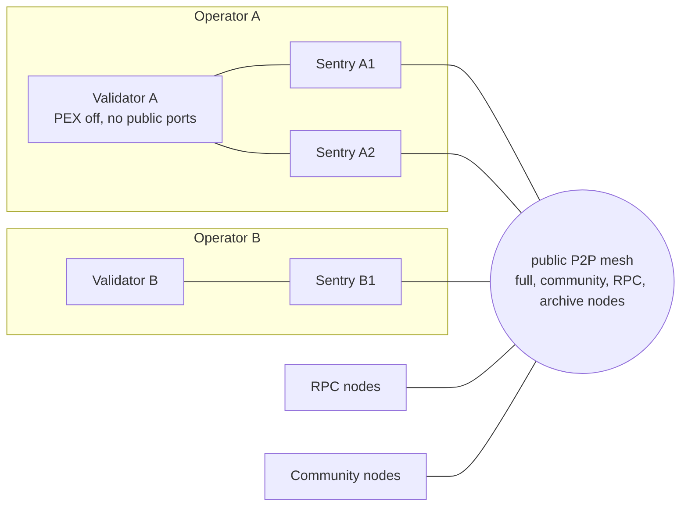

# Spec — NET: P2P topology and node configuration

- Version 0.1 (2026-11-25). Closes G-SPEC-4 at the configuration level. Unverified: no p2p skill is installed; built from CometBFT 0.38 configuration semantics.
- Engine: CometBFT 0.38 P2P. Authenticated, encrypted connections (SecretConnection, node keys), PEX discovery, block sync, state sync. No custom networking code.

## Topology

- **Validators never expose P2P or APIs publicly.** They peer only with their own sentries (persistent and unconditional, PEX off). Sentries keep the validator's node ID in `private_peer_ids`, so it is never gossiped. This defeats targeted DoS and eclipse attacks on validators.
- **Every other node is permissionless** and joins the public mesh through seeds and PEX. Gossip is an overlay with bounded degree (inbound ≤ 80 on sentries, 40 on RPC nodes, 20 on community nodes), so the network doesn't need all-to-all connections.
- **Diversity:** operators run sentries in at least 2 regions or providers. Seeds and persistent peers published per network come from ≥ 3 independent operators (eclipse resistance, TM-07).

## Role profiles (`scripts/node-profile.py <role>`)

| Role | P2P | APIs | Pruning / snapshots | Notes |
|---|---|---|---|---|
| validator | PEX off; persistent + unconditional = own sentries; inbound/outbound ≤ 10 | REST/gRPC/JSON-RPC off; RPC on localhost | default; no snapshots | `double_sign_check_height = 10`: refuses to sign if its key signed in the last 10 blocks (protects against an accidental duplicate node) |
| sentry | PEX on; inbound 80 / outbound 20; validator in `private_peer_ids` | off | default | public face of the validator |
| rpc | PEX on; 40 / 10 | REST, gRPC, JSON-RPC (`eth,net,web3,txpool`), gas-cap 25 M, logs-cap 10 000, block-range-cap 10 000 | default | put behind a reverse proxy with rate limits (TM-09) |
| archive | PEX on | on | `pruning = nothing`; snapshots every 1 000 blocks (state-sync provider) | historical queries |
| community | PEX on; 20 / 10 | REST/gRPC on localhost only (for `tx community run`), JSON-RPC off | default (keeps far more than `apphash_window + epoch_blocks`) | consumer hardware |

Common to all roles: Prometheus on `127.0.0.1:26660` only, pprof off, 20 MB/s send and receive rate limits, strict address book (except the validator, whose sentries may be on private addresses).

## Synchronisation
- New nodes: state sync from snapshots served by archive/RPC nodes, light-client-verified against ≥ 2 RPC servers and a trust hash from ≥ 2 independent sources (`tests/sync/check_sync.sh`).
- Returning nodes: block sync from peers. A node offline longer than the unbonding period (21 days) must state-sync from a fresh trusted hash (weak subjectivity, TM-04).

## Status
- Profiles: implemented and applied to fresh homes in tests (idempotent).
- Live sentry topology: **not yet exercised** in an automated multi-host test (needs infrastructure, G-OPS-3).
